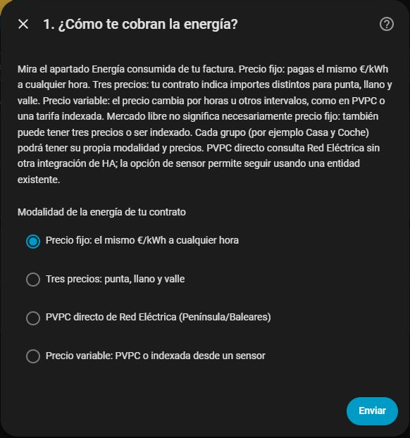
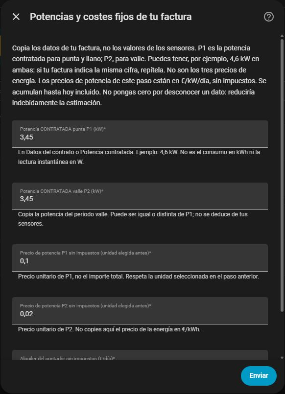

<div align="center">


# Luz en Cifras

**Entiende de qué está hecha tu factura eléctrica.**

Consumo, potencia e impuestos en Home Assistant, con cálculo local y desglose visible.

[](https://github.com/Carbanog/luz-en-cifras/actions/workflows/ci.yml)
[](https://github.com/Carbanog/luz-en-cifras/actions/workflows/validate.yml)

[](LICENSE)
[](https://buymeacoffee.com/Carbanog)

[Instalar](#instalación) · [Configurar](#configuración) · [Dashboard](#dashboard) · [Limitaciones](#limitaciones) · [Incidencias](https://github.com/Carbanog/luz-en-cifras/issues)

</div>

> [!NOTE]
> Los importes son estimaciones y deben contrastarse con tu factura real.
> No sustituyen la factura de tu comercializadora.

## Qué puedes probar

La integración convierte sensores W/kW y Wh/kWh en una estimación de factura
eléctrica española. El cálculo es local. PVPC directo consulta precios públicos de
Red Eléctrica, sin cuentas ni credenciales; las otras modalidades leen datos locales.


*Captura real de HA con consumos simulados identificados como PRUEBA.
[Elige dashboard nativo o Mushroom y adáptalo a tu contrato](docs/dashboards.md).*

| Función | Disponible hoy |
| --- | --- |
| Contratos | Varias configuraciones independientes |
| Grupos de consumo | Suma de contadores y resta explícita de subcontadores |
| Energía | Precio fijo, tres periodos 2.0TD o entidad dinámica/PVPC por grupo |
| Potencia | P1/P2 en €/kW/día o €/kW/año, con revisiones fechadas |
| Alquiler | Cargo diario configurable |
| Impuestos | Porcentajes manuales por contrato, editables y sin caducidad mensual |
| Persistencia | Consumos guardados localmente entre reinicios |
| Desglose | Sensores de energía, potencia, impuestos y calidad de datos |
| Conceptos opcionales | Cuota diaria, servicio por factura y descuento energético |
| Excedentes | Precio acordado fijo y compensación limitada al valor de energía |
| Históricos | Cierre automático/manual, exportación, comparación y revisión auditable |
| Diagnóstico | Datos anonimizados y aviso Repairs cuando falta una regla fiscal |

Consulta la [matriz de cobertura](docs/cobertura.md): distingue las modalidades
disponibles de los casos que todavía requieren desarrollo y verificación.

### Objetivo: cada contrato con sus módulos

Cada grupo tiene su modalidad de tarifa y sus fuentes. Solo configuras los conceptos
adicionales que necesites. El asistente separa selección de contadores y precios,
mostrando únicamente los campos de la tarifa elegida. La interfaz está en español;
también usa español como fallback cuando HA está configurado en otro idioma.

**No necesitas Docker.** Es una integración HACS. El contenedor del repositorio se
utiliza exclusivamente para ejecutar pruebas de desarrollo con HA real.

## Instalación

**Compatibilidad probada: Home Assistant 2026.10.2, 2026.10.3 y 2026.10.4**, Python 3.14.2 o posterior.
Otras versiones de HA requieren validación. Puedes elegir directamente sensores de
potencia **W/kW** o contadores acumulados **Wh/kWh**, incluso varios y mezclados en
un grupo. La unidad se detecta automáticamente. No necesitas ayudantes Integral.
La energía calculada desde potencia es una estimación marcada como parcial.
[Selección de sensores, precisión y caducidad](docs/sensores.md).

Para pasar del HA de pruebas al uso habitual sigue la
[guía de validación durante varios días](docs/validacion-en-ha.md). Define qué
comprobar y cuándo dar por aceptada una versión, sin cambiar de código durante la
prueba salvo que haya una corrección necesaria.

### Con HACS · repositorio personalizado

1. En HACS abre **⋮ → Repositorios personalizados**.
2. Añade esta dirección con categoría **Integración**:

   ```text
   https://github.com/Carbanog/luz-en-cifras
   ```

3. Busca **Luz en Cifras**, descárgala y reinicia Home Assistant.
4. Ve a **Ajustes → Dispositivos y servicios → Añadir integración**.
5. Busca **Luz en Cifras** y crea tu contrato.

Todavía no pertenece al catálogo predeterminado de HACS. Las versiones instalables
se publican en [Releases](https://github.com/Carbanog/luz-en-cifras/releases), con sus
cambios e instrucciones. HACS utiliza esas versiones para ofrecer actualizaciones.
Si instalaste `main`, usa **Volver a descargar** en el menú del repositorio de HACS
y selecciona la release más reciente para pasar al seguimiento por versiones. Reinicia HA después.
La rama `main` queda disponible para desarrollo.

<details>
<summary><strong>Instalación manual</strong></summary>

1. [Descarga el código de la versión](https://github.com/Carbanog/luz-en-cifras/releases/latest) desde **Source code (zip)** y descomprímelo.
2. Copia `custom_components/luz_en_cifras` dentro de tu directorio de configuración.
3. Comprueba la estructura y reinicia Home Assistant:

   ```text
   config/
   └── custom_components/
       └── luz_en_cifras/
           ├── manifest.json
           ├── __init__.py
           ├── config_flow.py
           └── …
   ```

4. Añade la integración desde **Ajustes → Dispositivos y servicios**.

Evita copiar el repositorio completo en `custom_components` o duplicar la carpeta.

</details>

## Configuración

Ten a mano tu contrato o factura e introduce **precios sin impuestos**.

El alta comienza por **la modalidad de energía**: precio fijo, tres precios
punta/llano/valle, PVPC directo o precio variable desde una entidad. Mercado libre
no significa necesariamente precio fijo. Después se piden el periodo, los sensores
y los precios del grupo; finalmente, la potencia contratada, el alquiler y los impuestos.

**¿Tienes varios sensores y precios distintos?** El precio se configura por grupo,
no por sensor. Los sensores del mismo grupo se suman y comparten su tarifa; para
precios distintos, crea grupos distintos dentro del mismo contrato.
[Ver ejemplos y pasos para Casa y Coche](#varios-sensores-y-precios-distintos-casa-y-coche).

**Potencia contratada no es consumo:** P1 y P2 son los kW que figuran en tu contrato
para punta y valle. No se copian los W instantáneos de los sensores ni los tres
precios de energía. Si tu factura indica 4,6 kW en ambos periodos, introduce 4,6 en
ambos campos. Primero se elige si su precio está en €/kW/día o €/kW/año. Cada campo
incluye ayuda. Si HA muestra cero inicialmente, sustitúyelo por el dato de tu factura:
solo es válido cuando realmente no se contrata o cobra ese concepto.

<details>
<summary><strong>Ver el asistente: modalidad y potencia P1/P2</strong></summary>

**1. Elige cómo te cobran la energía.** Cada grupo puede tener después una modalidad
y precio propios. Para sumar dos sensores de Casa basta con elegir ambos como
fuentes de ese grupo; Coche puede ser otro grupo con otro precio.



**2. Copia la potencia contratada y su precio unitario.** P1/P2 se solicitan también
con precio fijo o PVPC. La captura usa valores ficticios de pruebas: no los copies.
Busca los tuyos en el contrato o factura y respeta la unidad elegida antes.



</details>

El mes de referencia solo se pide en ciclos bimestrales. Caducidad, reparto temporal
y visibilidad del desglose están en **Ajustes avanzados de medición**. Los contratos
existentes conservan sus campos, consumos e identificadores.

| Campo | Qué introducir |
| --- | --- |
| Nombre | Un nombre reconocible: Casa, Garaje… |
| Día de inicio | Día del mes en que comienza el ciclo mensual o bimestral |
| Potencia P1/P2 | Potencia contratada en kW por periodo |
| Precio P1/P2 | Precio según la unidad **€/kW/día** o **€/kW/año** elegida |
| Alquiler | Importe diario del contador, sin IVA |
| Grupos | Contadores que suman o restan y precio en **€/kWh** |
| Caducidad de potencia | Tiempo sin reportes antes de detener la integración de W/kW; 5 minutos por defecto |

Puedes añadir, editar o eliminar grupos desde las opciones. Encontrarás el
dispositivo del contrato y los sensores por grupo en **Ajustes → Dispositivos y
servicios**. Renombrar conserva sus identificadores únicos. Puedes cambiar sensores,
grupos y modalidades durante el ciclo: se conserva lo acumulado, cada tramo mantiene
sus fuentes y precios y los cargos fijos se calculan una sola vez para la factura.
Los cambios se aplican al guardar; no permiten indicar fechas retroactivas.

Un contador nuevo espera una lectura real como referencia y después acumula sus
incrementos; su valor anterior en HA no se interpreta como consumo desde el cambio.
Mientras faltan mediciones se muestra la parte conocida con una advertencia; un grupo
sin mediciones queda desconocido, no a cero. Si una lectura cruza una frontera y no
permite un reparto exacto, se requiere autorizar la estimación temporal en Avanzado.
Consulta [actualización y compatibilidad](docs/migracion.md).

### Tres periodos y PVPC

Selecciona **Tres periodos 2.0TD** para introducir P1/P2/P3. Para PVPC puedes elegir
**PVPC directo de Red Eléctrica (Península/Baleares)**: obtiene el FEU horario sin
impuestos, sin otra integración ni sensor de precio. Aparece un sensor por grupo
con el precio publicado de la hora actual. Necesita Internet y conserva las horas
descargadas; una caída de red no prolonga un precio más allá de su hora publicada.

También puedes seguir usando el sensor de la integración nativa PVPC o una entidad
indexada mediante **Precio variable desde un sensor**. No vuelvas a sumar peajes y
cargos ya incluidos. [Fuente, caché y límites](docs/tarifas.md).

Si una lectura acumulada atraviesa varios precios, el reparto exacto es desconocido.
Puedes activar el reparto uniforme temporal, marcado como parcial. Un precio ausente
o caducado no se convierte en cero. [Guía de tarifas y precisión](docs/tarifas.md).

### Impuestos manuales, como en tu factura

Introduce el **impuesto eléctrico (%)**, el **IVA / impuesto indirecto (%)** y el
**mínimo del impuesto eléctrico (€/MWh)**. Confirma que los has revisado con tu
factura o contrato. Por ejemplo, 21 significa 21 %, no 0,21; los valores sugeridos
se deben comprobar antes de guardar.

Se mantienen hasta que tú los cambies: **sin Internet, consultas al INE, fecha de
caducidad ni actualizaciones mensuales de la integración**. Se aplican también a
precio fijo y tres periodos; el PVPC solo descarga el precio de la energía.
Por eso energía, potencia y alquiler se introducen sin impuestos.

Desde **Configurar → Impuestos de la factura** puedes modificarlos. Cambiar impuestos
recalcula la factura abierta; las facturas cerradas conservan su desglose. Si pasas
desde el antiguo modo automático, se pide una **confirmación única** y se conservan
las mediciones mientras tanto. [Impuestos y actualización](docs/reglas-fiscales.md).

### Históricos y factura real

El cierre de ciclo conserva los datos y el desglose. Desde las acciones nativas de
HA puedes exportarlos, cerrar fechas reales, comparar con una factura y crear una
revisión conservando el original. El devengo se indica por separado del periodo de
consumo. [Cómo usar los históricos](docs/historicos.md).

### Varios sensores y precios distintos: Casa y Coche

Un **contrato** reúne el periodo de factura, la potencia, el alquiler y los impuestos.
Dentro del contrato, cada **grupo de consumo** reúne sensores y tiene su propio
precio o modalidad de tarifa. No hace falta crear otro contrato para dar al coche
un precio diferente: así los cargos fijos se calculan una sola vez.

| Lo que quieres medir | Cómo configurarlo |
| --- | --- |
| Dos sensores al mismo precio | Un grupo con ambos en **Sensores que suman** |
| Dos sensores a precios distintos | Dos grupos, cada uno con su sensor y su precio |
| Dos filas de Casa y un cargador con otro precio | Grupo **Casa** con las dos filas y grupo **Coche** con el cargador |

Por ejemplo, si las filas de Casa **no incluyen** el consumo del coche:

| Grupo | Sensores que suman | Precio fijo sin impuestos, solo de ejemplo |
| --- | --- | --- |
| Casa | Fila 1 + Fila 2 | 0,120 €/kWh |
| Coche | Cargador | 0,075 €/kWh |

**Cómo hacerlo en un contrato existente:**

1. Abre **Ajustes → Dispositivos y servicios → Luz en Cifras → Configurar**
   en el contrato correspondiente.
2. En **Editar o eliminar un grupo**, elige el grupo actual. Deja en
   **Sensores que suman** únicamente los sensores que deben compartir su tarifa.
   Revisa su **Modalidad de tarifa** y, en el paso de precios, introduce su precio.
3. Vuelve al menú y pulsa **Añadir grupo de consumo**. Ponle un nombre como
   **Coche**, selecciona su sensor y modalidad y configura su precio.
4. Repite si necesitas más grupos y termina con **Revisar validación y guardar**.

Si ya seleccionaste dos sensores juntos y querías precios diferentes, quita el
segundo del primer grupo y selecciónalo en el grupo nuevo. No lo dejes sumando en
ambos. Los cambios se aplican desde que guardas; no reasignan el consumo anterior.

**Si el contador de Casa ya incluye el coche**, selecciona el cargador en
**Subcontadores incluidos que se restan** del grupo Casa y también como sensor que
suma en el grupo Coche. El resultado será Casa = principal − cargador, y
Coche = cargador. La integración no deduce estas relaciones por los nombres.

Sustituye los precios de ejemplo por los de tu contrato, siempre sin impuestos.
Cada grupo también puede usar tres periodos o precio dinámico. No selecciones a
la vez W y kWh del mismo circuito: estarías contando dos veces la misma energía.

> [!TIP]
> La primera lectura establece el punto de partida. Espera nuevos cambios del
> contador para comprobar la acumulación. El periodo inicial será parcial.

## Dashboard

Elige una de las dos plantillas completas. Ambas tienen **Resumen** (factura,
consumo y grupos) y **Desglose** (conceptos e historial). Se adaptan al móvil y
mantienen visibles los avisos de calidad.
El resumen destaca el importe del ciclo y añade barras diarias y reparto por usos.
La cabecera está incluida en el YAML: no hay imágenes externas que instalar.

| Nativo | Mushroom |
| --- | --- |
| [Descargar YAML](examples/dashboard.yaml) | [Descargar YAML](examples/dashboard-mushroom.yaml) |
| Sin tarjetas adicionales | Requiere Mushroom 5.x desde HACS |
| Consumo y coste por grupo separados | Consumo y coste juntos en cada grupo |


*Consumos simulados, no una factura real. Mushroom es opcional.*

1. Activa **Mostrar entidades de desglose y grupos** si lo habías desactivado.
2. Sustituye **todas** las entidades `sensor.mi_contrato_*` por las de tu dispositivo.
3. Crea un dashboard **nuevo** y pega el archivo completo en su
   **Editor de configuración en bruto**. No se pega en `configuration.yaml`.

La [guía con capturas, tabla de entidades e instalación paso a paso](docs/dashboards.md)
explica cómo dejar solo un grupo, añadir más, mostrar el PVPC y resolver errores.
Los dashboards se copian por separado; HACS no modifica tus paneles existentes.

## Limitaciones

| Situación | Comportamiento actual |
| --- | --- |
| Primer periodo | Parcial; sin consumo anterior a la instalación |
| Potencia y alquiler | Se acumulan hasta hoy incluido; todavía no hay prorrateo intradía |
| Editar precios | Conserva el pasado; cambios desde la revisión guardada |
| Cambios de impuestos | Debes editar los porcentajes si cambia tu factura; no se detectan automáticamente |
| Cierre automático | Devengo provisional al último día del consumo, revisable con la fecha real |
| Contratos indexados | Aportar una entidad de precio completo; no genera fórmulas comerciales arbitrarias |
| Compensación de excedentes | Básica con precio fijo acordado, ciclo mensual y contador separado |
| Batería virtual y bono social | Sin gestión automática de saldos, elegibilidad o límites sociales |
| Otros territorios | Sin perfil territorial automático; un porcentaje manual no reproduce todas sus particularidades |
| Histórico anterior a la instalación | Sin importación de Recorder/Datadis ni reconstrucción automática |
| Cuotas planas y promociones complejas | Sin regularización específica automática |

El calendario 2.0TD verificado incluido cubre 2026 en Península y Baleares. El perfil
manual no calcula elegibilidad para exenciones ni todas las bases de otros territorios.
Los impuestos introducidos no caducan al cambiar de mes o año. No se anuncian como
terminados los supuestos sin pruebas. [Criterios y límites](docs/reglas-fiscales.md).

<details>
<summary><strong>Resolución de problemas</strong></summary>

- **No aparece:** comprueba la ruta de `manifest.json`, reinicia HA y revisa el registro.
- **No puedes guardar un sensor:** comprueba que su unidad sea W, kW, Wh o kWh.
- **El consumo no cambia:** espera nuevos cambios; no se reconstruye el pasado.
- **Importe indisponible:** consulta el sensor de calidad y atributos `error` y `warnings`.
- **No coincide con la factura:** revisa cobertura, unidades y precios sin impuestos.

Para [abrir una incidencia](https://github.com/Carbanog/luz-en-cifras/issues),
incluye versiones de HA e integración, pasos para reproducir, unidades y mensajes
anonimizados. Evita facturas completas o datos personales.

</details>

## Actualización y recuperación

Haz una copia de seguridad de HA antes de actualizar. Con HACS, descarga la
actualización y reinicia; manualmente, reemplaza la carpeta de la integración.
Conserva la versión anterior y el respaldo de datos para restaurarlos si es necesario.

**Desde 0.3.0 a 0.3.1:** los contratos automáticos requieren revisar y confirmar sus
impuestos una sola vez. La configuración pasa a minor 4, conservando Store 3 e
históricos. Para volver a 0.3.0 restaura también la copia de configuración de HA;
no basta con volver a descargar el código antiguo. [Detalles](docs/migracion.md).

**Si actualizas desde 0.1**, consulta la [guía de migración](docs/migracion.md). Se
conserva una copia del payload antiguo, pero volver a 0.1 requiere restaurar también
su almacenamiento, no solo sus archivos Python.

No elimines la entrada para actualizar: eliminarla borra su almacenamiento asociado.
Conserva el respaldo de HA para recuperar también los datos.

## Desarrollo y transparencia

Desarrollado **con ayuda de OpenAI Codex**, bajo la dirección de **Carbanog**.
La asistencia de IA forma parte de la implementación y documentación. Las pruebas
automatizadas verifican parte del comportamiento; la validación real con HA y
facturas sigue siendo necesaria antes de considerar el producto estable.

El motor usa `Decimal` y está separado del adaptador HA. La CI comprueba formato,
análisis estático, tipos y pruebas, e importa la integración contra HA de referencia.
Otro trabajo ejecuta pruebas funcionales con los fixtures de HA real. Hassfest y
HACS validan estructura y metadatos. [Pruebas reproducibles](docs/pruebas.md).

```shell
python -m pip install -e ".[dev]"
ruff format --check .
ruff check .
mypy
pytest
```

[Contribuir](CONTRIBUTING.md) · [Arquitectura](docs/arquitectura.md) ·
[Referencias y licencias](docs/investigacion-mercado.md) · [Cambios](CHANGELOG.md) ·
[Seguridad](SECURITY.md)

## Privacidad

Sin CUPS, DNI, dirección, credenciales, telemetría ni servidor propio.
Los datos se guardan en Home Assistant. [Más información](docs/privacidad.md).

## Apoyar el proyecto

Si te resulta útil, puedes apoyar su mantenimiento con un café. Es opcional;
todas las funciones están disponibles sin aportaciones.

[☕ Invítame a un café en Buy Me a Coffee](https://buymeacoffee.com/Carbanog)

---

Hecho por **Carbanog**, con ayuda de **Codex** · [Licencia MIT](LICENSE)
