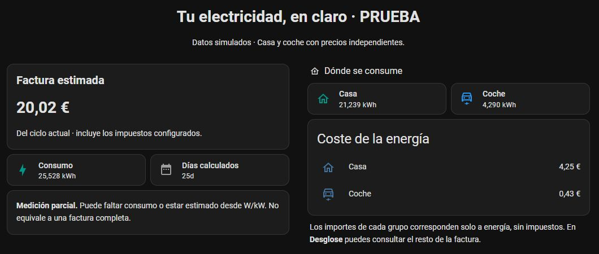
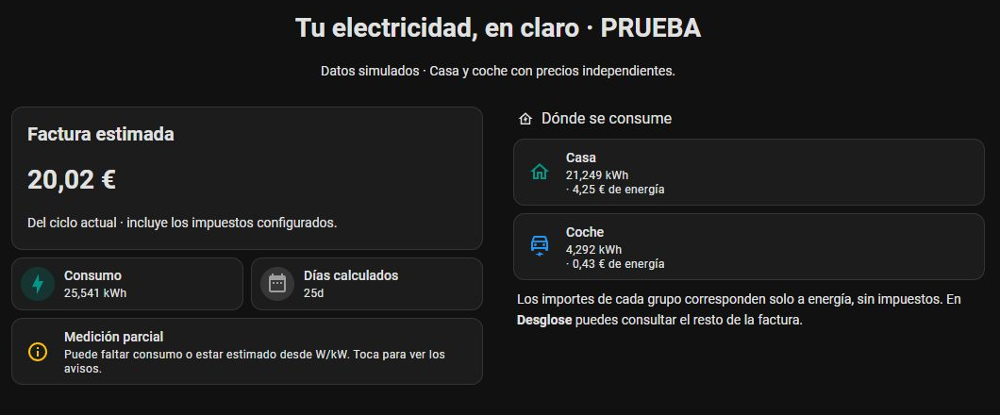
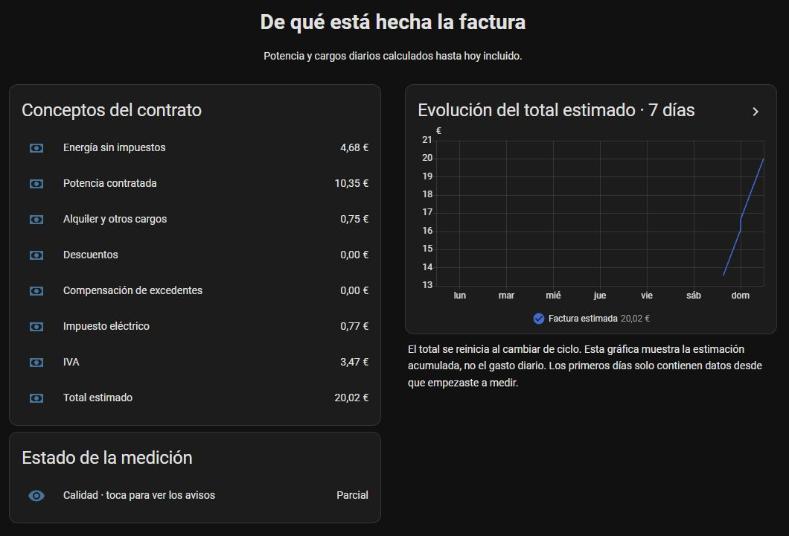
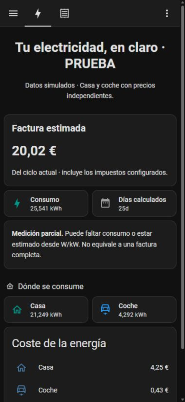
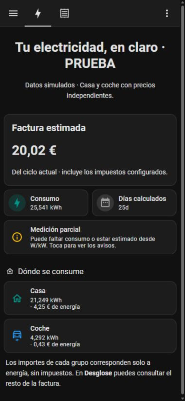

# Tu factura en el dashboard

Dos configuraciones completas, con el mismo contenido y dos pestañas:
**Resumen** para consultar a diario y **Desglose** para entender los importes.
Las tarjetas leen las entidades de Luz en Cifras; no crean sensores ni cambian
el contrato. No requieren automatizaciones, temas, card-mod ni servicios externos.

| Variante | Descargar YAML | Requisitos comprobados |
| --- | --- | --- |
| Nativa | [dashboard.yaml](../examples/dashboard.yaml) | HA 2026.10.3; ninguna tarjeta adicional |
| Mushroom | [dashboard-mushroom.yaml](../examples/dashboard-mushroom.yaml) | HA 2026.10.3 + Mushroom 5.2.3 |

Las capturas proceden de un HA real con **consumos simulados**, marcados como
PRUEBA. Son ejemplos del aspecto, no una factura real ni valores que debas copiar.

## Elige el aspecto

### Tarjetas nativas



### Mushroom



Mushroom es opcional. Si eliges esta variante, descárgalo desde **HACS → Mushroom**
y vuelve a cargar el navegador cuando HACS lo indique. La plantilla usa la tarjeta
Template actual con `color`, no la antigua configuración `icon_color` de Template.
Las tarjetas Entity sí utilizan `icon_color`. Consulta la
[instalación de Mushroom](https://github.com/piitaya/lovelace-mushroom#installation)
si no aparecen las tarjetas; no añadas recursos duplicados.

## 1. Localiza tus entidades

En **Ajustes → Dispositivos y servicios → Luz en Cifras**, abre el dispositivo
de tu contrato. En **Configurar → Ajustes avanzados de medición** activa
**Mostrar entidades de desglose y grupos** si estaba desactivado.

Abre cada entidad y entra en su configuración para copiar el **ID de entidad**.
También puedes encontrarlas en **Herramientas → Estados** buscando el nombre del
contrato. Usa los sensores calculados por Luz en Cifras, no los sensores W originales.

Los nombres siguientes son marcadores que debes sustituir en **todo** el archivo,
incluidas las expresiones entre `{{ ... }}` y los campos `entity_id` de Mushroom.
No se detectan automáticamente por el nombre.

| Marcador de la plantilla | Entidad que debes buscar |
| --- | --- |
| `sensor.mi_contrato_factura_actual_estimada` | Factura actual estimada |
| `sensor.mi_contrato_energia_del_periodo` | Energía del periodo |
| `sensor.mi_contrato_dias_del_periodo` | Días del periodo |
| `sensor.mi_contrato_calidad_de_los_datos` | Calidad de los datos |
| `sensor.mi_contrato_casa_energia` | Tu grupo Casa — energía |
| `sensor.mi_contrato_casa_coste_de_energia` | Tu grupo Casa — coste de energía |
| `sensor.mi_contrato_coche_energia` | Tu grupo Coche — energía |
| `sensor.mi_contrato_coche_coste_de_energia` | Tu grupo Coche — coste de energía |
| `sensor.mi_contrato_coste_de_energia` | Coste de energía del contrato |
| `sensor.mi_contrato_coste_de_potencia` | Coste de potencia |
| `sensor.mi_contrato_otros_cargos` | Otros cargos, incluido alquiler |
| `sensor.mi_contrato_descuentos` | Descuentos |
| `sensor.mi_contrato_compensacion_de_excedentes` | Compensación de excedentes |
| `sensor.mi_contrato_impuesto_electrico` | Impuesto eléctrico |
| `sensor.mi_contrato_iva` | IVA |

Por ejemplo, si HA creó `sensor.vivienda_cargador_energia`, sustituye
`sensor.mi_contrato_coche_energia` por ese ID. Los identificadores pueden llevar
sufijos como `_2`; copia el que existe en tu HA. Renombrar el contrato no garantiza
que cambien los IDs que ya estaban registrados.

## 2. Crea un dashboard nuevo

1. Descarga el YAML de la variante elegida con **Raw / Descargar archivo** en GitHub.
2. Sustituye los IDs según la tabla anterior en un editor de texto.
3. Ve a **Ajustes → Paneles de control → Añadir panel de control → Desde cero**.
   Dale nombre, por ejemplo **Electricidad**.
4. Ábrelo y selecciona **Editar panel de control → ⋮ → Editor de configuración en bruto**.
5. Reemplaza el contenido del **dashboard nuevo** por el archivo completo y guarda.
6. Cierra el editor y pulsa **Hecho**. Deben aparecer **Resumen** y **Desglose**.

> [!IMPORTANT]
> El archivo incluye `title:` y `views:`: es un dashboard completo, no una tarjeta.
> No se pega en `configuration.yaml` ni en el editor de una tarjeta manual.
> Pégalo en uno nuevo para conservar tus otros paneles. La antigua plantilla del
> repositorio era una sola vista; estas dos configuraciones completas la sustituyen.

Para añadirlo a un dashboard existente, guarda antes una copia de su configuración
y añade únicamente los elementos de la lista `views:` a su lista de vistas, cuidando
la indentación y evitando rutas de vista duplicadas. El método más sencillo es
mantener un dashboard independiente.

## 3. Ajusta solo lo que necesitas

**Un único grupo.** En Resumen elimina las tarjetas de Coche y la fila Coche en
Coste de la energía (nativo). En Mushroom basta con eliminar la tarjeta de Coche.
Puedes renombrar Casa como Consumo. El total del contrato sigue siendo el mismo.

**Más grupos.** Duplica una tarjeta de grupo y cambia nombre e IDs. En la variante
nativa añade también su fila de coste; en Mushroom sustituye ambos IDs y la lista
`entity_id`. No sumes importes en el dashboard: el total ya lo calcula la integración.

**Varios contratos.** Crea un dashboard por contrato o duplica las dos vistas con
rutas distintas y reemplaza sus IDs. Los grupos mostrados deben pertenecer al mismo
contrato que el total; compruébalo al adaptar la plantilla.

**Sin descuentos ni excedentes.** Puedes quitar esas filas de Desglose. No afecta
al cálculo y permite dejar solo los conceptos de tu factura.

**PVPC directo.** Añade opcionalmente esta tarjeta a la lista `cards:` de una
sección de Resumen y sustituye su entidad por el precio de tu grupo. Solo existe
si elegiste PVPC directo y muestras las entidades de desglose.

```yaml
type: tile
entity: sensor.mi_contrato_casa_precio_pvpc_sin_impuestos
name: PVPC de esta hora · sin impuestos
icon: mdi:clock-outline
color: amber
tap_action:
  action: more-info
```

Una tarifa fija no necesita esa tarjeta. El **precio medio efectivo** incluye
otros conceptos y no es tu tarifa de energía: por eso se omite del resumen.

## Cómo leer los datos

La factura es el total estimado del ciclo. La energía de cada grupo y su coste
permiten comparar Casa y Coche; los costes por grupo están **sin impuestos** y no
incluyen los cargos fijos. Potencia y alquiler pueden cubrir días anteriores al
primer consumo registrado: no implica que se haya reconstruido ese consumo.

**Parcial** significa que puede faltar cobertura o que se estima energía desde
potencia. **Completo** se refiere al tramo registrado, no garantiza coincidencia
con la factura comercial. Un error o ausencia de datos se muestra como pendiente
o no disponible; las plantillas no sustituyen esos estados por cero.

Toca una tarjeta de consumo para ver su entidad e historial. En Mushroom también
puedes tocar el aviso de calidad; en ambas variantes lo encontrarás en Desglose.
Sus atributos incluyen los avisos, periodo y regla fiscal aplicada.



La gráfica requiere historial de HA. Muestra el **total acumulado**, que se
reinicia al cambiar de ciclo; no representa el gasto de cada día. No rellena
los días anteriores a la instalación.

## En el móvil

Las secciones pasan de dos columnas a una, conservando el total primero.
No necesitas otra plantilla ni cambiar el tema.

| Nativo · 390 px | Mushroom · 390 px |
| --- | --- |
|  |  |

## Si algo no aparece

| Mensaje o síntoma | Qué comprobar |
| --- | --- |
| Entidad no encontrada | Sustituye todos los marcadores y comprueba el ID, incluidos sufijos |
| Custom element doesn't exist: mushroom… | Instala Mushroom con HACS y recarga el navegador; revisa sus recursos |
| Pendiente de datos / no disponible | Abre Calidad de los datos; espera lecturas nuevas o revisa sus errores |
| Solo aparece una entidad del contrato | Activa Mostrar entidades de desglose y grupos |
| Gráfica vacía | Espera historial; comprueba que Recorder incluya la entidad |
| El total no es la suma de Casa y Coche | Sus importes son solo energía; revisa potencia, alquiler e impuestos en Desglose |

Las plantillas son opcionales y se descargan por separado. HACS actualiza la
integración, pero no sobrescribe tus dashboards ni adapta sus entidades.
Para volver atrás restaura el YAML que guardaste; las tarjetas no modifican los
datos de la integración.

## Criterio de diseño y validación

El importe del ciclo es el punto de entrada; el reparto por usos lo explica y el
desglose queda en una segunda pestaña. Ámbar identifica atención y turquesa/azul
distinguen usos sin depender exclusivamente del color. Se respeta el tema de HA.

Comprobado en HA 2026.10.3 y Mushroom 5.2.3, a 390 y 1440 px: carga de ambas
plantillas, entidades, apertura de más información y pestaña de desglose.
Las capturas son de consumos simulados. La comprobación visual cubre el tema
oscuro mostrado; no constituye una auditoría completa WCAG ni prueba de todos
los temas de terceros. No se modifica el motor de cálculo.

Referencias: [secciones de HA](https://www.home-assistant.io/dashboards/sections/),
[tarjetas Tile](https://www.home-assistant.io/dashboards/tile/),
[Template de Mushroom](https://github.com/piitaya/lovelace-mushroom/blob/v5.2.3/docs/cards/template.md).
